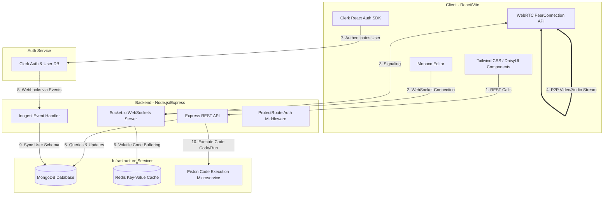

# 🔗 Synapse — Collaborative Coding & Interview Platform

Synapse is a real-time collaborative coding and technical interview platform. It enables multiple developers or interviewers/candidates to write and execute code together, engage in low-latency WebRTC video/audio calls, chat in real-time, and manage practice problems.

---

## 🏗️ System Architecture

Synapse follows a modern, real-time distributed architecture utilizing **Express**, **Socket.io**, **Redis**, **MongoDB**, and **Inngest** on the backend, paired with **React**, **TailwindCSS**, **Monaco Editor**, and **WebRTC** on the frontend.

### 📐 High-Level Architecture Diagram



### 🛰️ Flow Descriptions & Architecture Layers

1. **Authentication Layer**: 
   * Powered by **Clerk**. The client uses the `@clerk/clerk-react` SDK to manage session tokens.
   * Every incoming HTTP request to protected server API routes passes through the `ProtectRoute` middleware, resolving the user details against Clerk's authorization headers.
2. **User Synchronization Layer**: 
   * When a user signs up or deletes their account on Clerk, a webhook event is dispatched to the backend.
   * This is handled asynchronously via **Inngest** in `inngest.js`. The backend synchronizes user identities to MongoDB (`User.js`) for fast queries and relationship mappings (e.g., active sessions, hosts, participants).
3. **Real-time Code Collaboration**:
   * Collaborative rooms are established via **Socket.io**. Every code stroke in the Monaco Editor triggers `code-change` events, which are broadcasted to other participants in the room.
   * To prevent race conditions during page reloads, the active editor state is buffered in **Redis** with a 24-hour expiration (`session:${roomId}:code`). When joining, the user is synced using this cache.
4. **Peer-to-Peer Video Call**:
   * The video and audio calling module is built on pure **WebRTC** PeerConnection API.
   * **Socket.io** is used as the signaling channel to exchange SDP Offers, Answers, and ICE Candidates between the host and the participant. The video streams run peer-to-peer, bypassing server network overhead.
5. **Code Execution Pipeline**:
   * The Monaco Editor code outputs are evaluated by triggering the `executeCode` service inside the client, which forwards compiling requests to the server's code execution router integrated with the **Piston Microservice** engine.

---

## 🛠️ Technology Stack

| Category | Technology | Description |
|---|---|---|
| **Frontend Framework** | **React 19 (Vite)** | Fast HMR, component-driven UI architecture. |
| **Styling & Theme** | **Tailwind CSS & DaisyUI** | Sleek CSS utility styling and custom layout elements. |
| **Real-time Engine** | **Socket.io** | Two-way event-driven websocket protocol. |
| **Video Calling** | **WebRTC (PeerConnection)** | P2P video/audio conferencing. |
| **Authentication** | **Clerk** | Secure user management, session validation, and Webhook dispatching. |
| **Task Queues** | **Inngest** | Event-driven background runner for user database syncing. |
| **Primary Database** | **MongoDB (Mongoose)** | Schemas for Users and Sessions. |
| **Session Cache** | **Redis** | Temporary storage for active editor states. |
| **Code Editor** | **Monaco Editor** | Multi-language syntax highlighting, suggestions, and auto-formatting. |
| **Code Runner** | **Piston API** | Fast, sandbox-isolated code compiling and execution. |

---

## 📂 Project Structure

* [client](file:///d:/viswajith/PROJECTS-INTERN/Synapse/client) — Frontend client React application
  * [src/components](file:///d:/viswajith/PROJECTS-INTERN/Synapse/client/src/components) — Reusable UI components (Navbar, ActiveSessions, StatsCards, etc.)
    * [CodeEditorPanel.jsx](file:///d:/viswajith/PROJECTS-INTERN/Synapse/client/src/components/CodeEditorPanel.jsx) — Monaco Editor pane with language selection
    * [VideoCallUI.jsx](file:///d:/viswajith/PROJECTS-INTERN/Synapse/client/src/components/VideoCallUI.jsx) — Peer-to-peer WebRTC connection and room chat
    * [OutputPanel.jsx](file:///d:/viswajith/PROJECTS-INTERN/Synapse/client/src/components/OutputPanel.jsx) — Executed code output viewer
  * [src/pages](file:///d:/viswajith/PROJECTS-INTERN/Synapse/client/src/pages) — View pages (HomePage, DashboardPage, ProblemsPage, SessionPage)
  * [src/App.jsx](file:///d:/viswajith/PROJECTS-INTERN/Synapse/client/src/App.jsx) — React router config
* [server](file:///d:/viswajith/PROJECTS-INTERN/Synapse/server) — Backend Node/Express API server
  * [src/controllers/sessionController.js](file:///d:/viswajith/PROJECTS-INTERN/Synapse/server/src/controllers/sessionController.js) — Session management controller logic
  * [src/lib](file:///d:/viswajith/PROJECTS-INTERN/Synapse/server/src/lib) — Database connections, Redis initialization, and Inngest setup
  * [src/models](file:///d:/viswajith/PROJECTS-INTERN/Synapse/server/src/models) — User and Session database schemas
  * [src/server.js](file:///d:/viswajith/PROJECTS-INTERN/Synapse/server/src/server.js) — Express, Socket.io, and server bootstrapper
* [package.json](file:///d:/viswajith/PROJECTS-INTERN/Synapse/package.json) — NPM workspaces definitions for root directory

---

## ⚙️ Configuration & Environment Variables

You need to configure env variables for both client and server before launching.

### Client Environment Variables
Create a `.env` file under the `/client` directory:
```env
# Clerk identity keys
VITE_CLERK_PUBLISHABLE_KEY=your_clerk_publishable_key

# Backend API server endpoint
VITE_API_URL=http://localhost:3000/api
```

### Server Environment Variables
Create a `.env` file under the `/server` directory:
```env
PORT=3000
DB_URL=mongodb+srv://<username>:<password>@cluster.mongodb.net/synapse_DB
NODE_ENV=development

# Inngest Background Runner Secrets
INNGEST_EVENT_KEY=your_inngest_event_key
INNGEST_SIGNING_KEY=your_inngest_signing_key

# Clerk Auth Secrets
CLERK_PUBLISHABLE_KEY=your_clerk_publishable_key
CLERK_SECRET_KEY=your_clerk_secret_key

# Client Application URL
CLIENT_URL=http://localhost:5173

# Redis URI (Defaults to localhost if omitted)
REDIS_URL=redis://localhost:6379
```

---

## 🚀 Installation & Local Development

Follow these steps to run Synapse locally in development mode:

### Prerequisites
* **Node.js** (v18+)
* **MongoDB** (Local instance or Atlas cluster)
* **Redis** (Local or cloud server running)
* **Inngest Dev Server** (Required for webhook events simulation)

### 1. Clone the repository
```bash
git clone https://github.com/bhamidipativiswajith2007/Synapse-2.git
cd Synapse
```

### 2. Install dependencies & build
Install all project-wide workspaces, backend dependencies, and frontend packages simultaneously:
```bash
npm run build
```
*(This triggers recursive installation inside `/client` and `/server` subfolders and compiles the frontend assets).*

### 3. Run Redis Server
Ensure you have Redis running in the background:
```bash
redis-server
```

### 4. Run Inngest Dev Server (for auth sync/webhooks)
In a separate terminal, launch Inngest dev server pointing to the backend's local server port:
```bash
npx inngest-cli@latest dev -u http://localhost:3000/api/inngest
```

### 5. Launch the servers
To run the server in development mode (reloading on code changes):
```bash
# In server directory
cd server
npm run dev
```

To run the client app:
```bash
# In client directory
cd client
npm run dev
```

Now open your browser and navigate to `http://localhost:5173`.

---

## 🔒 Security & Performance Features

* **JWT Verification**: Clerk session credentials are parsed on every secure route block using custom authentication guards.
* **Cached Room Buffers**: Using Redis prevents data loss on client browser reloads, reducing Mongo writes during keystroke bursts.
* **WebRTC ICE Candidates**: Standard STUN/TURN protocols are used to ensure firewall traversal for P2P video stream synchronization.
* **Database Populates**: Query populates are restricted only to necessary profile data (`name`, `profileImage`, `clerkId`) preventing email exposure.
